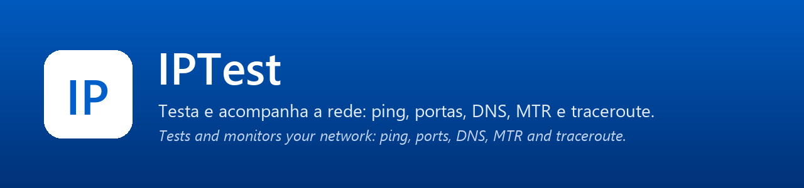
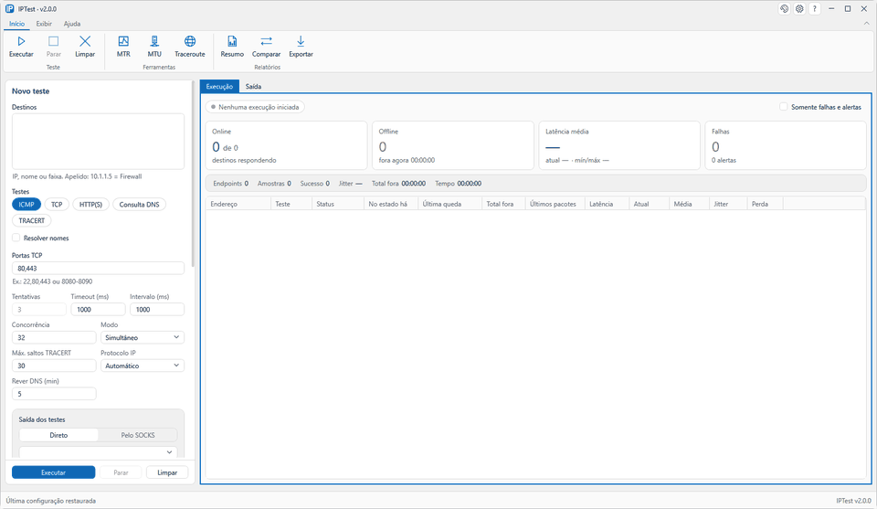
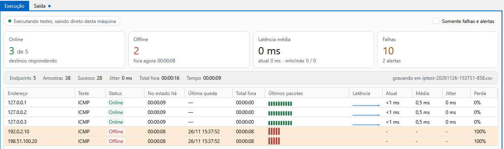
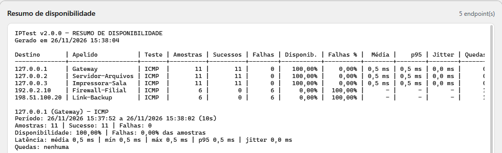
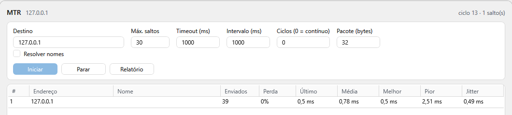
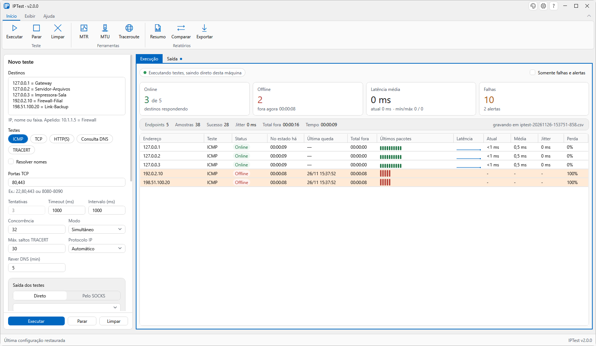
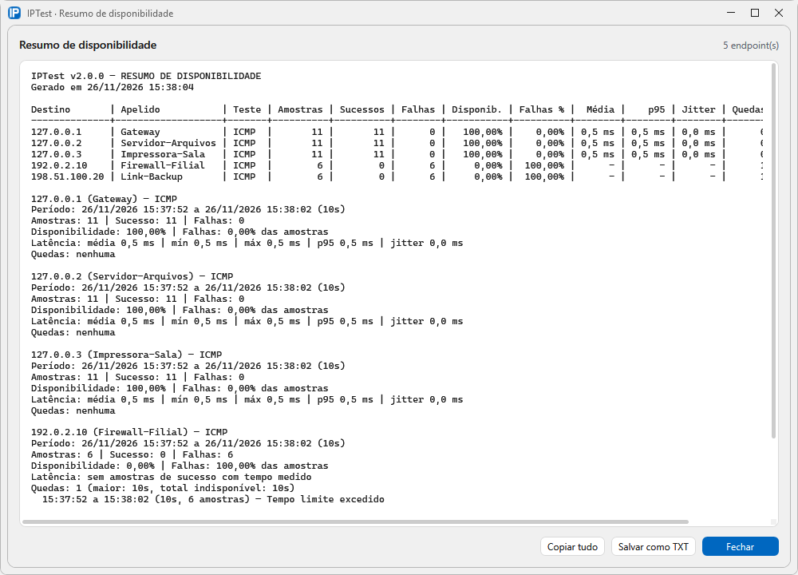
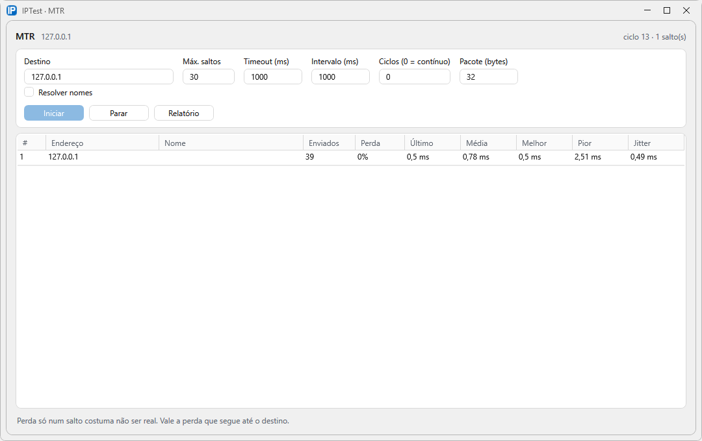
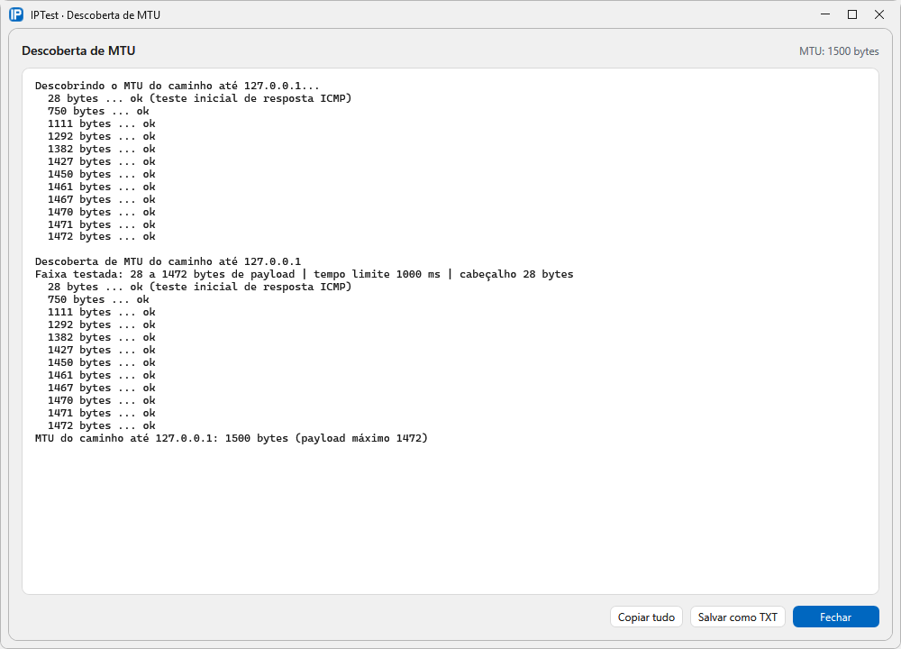
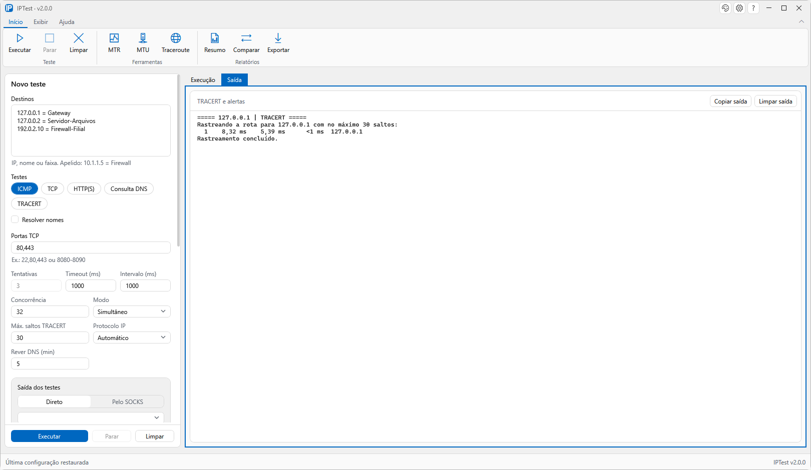

   

<b>Descubra em segundos o que está fora do ar na rede e tenha a prova pronta para o chamado.</b> <i>Find out in seconds what is down on the network and get the evidence ready for the ticket.</i>

## O que é / What it is
O IPTest é para quem cuida de rede e suporte. Ele testa muitos endereços ao mesmo tempo (ping, portas TCP, HTTP(S), DNS e traceroute), mostra na hora quem está online ou fora e gera um relatório com disponibilidade, latência e quedas para anexar ao chamado.
*IPTest is for network and support teams. It tests many addresses at once (ping, TCP ports, HTTP(S), DNS and traceroute), shows right away who is up or down and builds a report with availability, latency and outages to attach to the ticket.*

## Destaques / Highlights
| | |
|---|---|
| **Monitoramento ao vivo** — online, offline, latência e falhas de cada destino, atualizados em tempo real. *Live monitoring — online, offline, latency and failures per target, updated in real time.* |  |
| **Relatório para o chamado** — resumo de disponibilidade, latência e quedas, pronto para copiar ou salvar. *Ticket-ready report — availability, latency and outage summary, ready to copy or save.* |  |
| **MTR, MTU e traceroute** — encontre em qual salto a rede perde pacotes e qual o tamanho máximo do caminho. *MTR, MTU and traceroute — find which hop drops packets and the path's maximum size.* |  |

## Como funciona / How it works
1. Instale ou abra o portátil. / *Install or open the portable version.*
2. Cole os destinos (IP, nome ou faixa, com apelido) e escolha os testes. / *Paste the targets (IP, name or range, with nickname) and pick the tests.*
3. Clique em Executar, acompanhe ao vivo e gere o resumo ou exporte. / *Click Run, follow live and create the summary or export.*

## Funcionalidades / Features
| Recurso / Feature | O que faz / What it does |
|---|---|
| ICMP, TCP, HTTP(S), DNS | Testa vários destinos e portas ao mesmo tempo. / *Tests many targets and ports at once.* |
| Execução contínua | Acompanha a rede sem parar e grava o histórico em disco. / *Monitors nonstop and saves history to disk.* |
| Apelidos e faixas | `10.1.1.5 = Firewall` e faixas de IP na mesma lista. / *Nicknames and IP ranges in the same list.* |
| Resumo e comparação | Relatório de disponibilidade e comparação entre execuções. / *Availability report and run comparison.* |
| MTR, MTU, traceroute | Diagnóstico de caminho, perda por salto e MTU. / *Path diagnosis, per-hop loss and MTU.* |
| Saída por SOCKS | Testa direto ou através de um proxy SOCKS. / *Tests directly or through a SOCKS proxy.* |
| Exportar | Salva os resultados em arquivo (CSV/TXT). / *Saves results to file (CSV/TXT).* |
| Claro e escuro | Segue o tema do Windows. / *Follows the Windows theme.* |

## Galeria / Gallery
| | |
|---|---|
|  Janela principal com teste em andamento / *Main window with a test running* |  Resumo de disponibilidade / *Availability summary* |
|  MTR: perda e latência por salto / *MTR: loss and latency per hop* |  Descoberta de MTU / *MTU discovery* |
|  Traceroute na aba Saída / *Traceroute in the Output tab* | |

## Baixar / Download
- [GitHub — versão mais nova / latest (.msi e .zip)](https://github.com/Dorflex-DD/IPTest-releases/releases/latest)
- [GitLab — versão mais nova / latest (.msi e .zip)](https://gitlab.com/fabioffg/IPTest/-/releases/permalink/latest)

Windows 10/11 x64 · .NET 10 Desktop Runtime. O app avisa e instala as novas versões. / *The app notifies and installs new versions.*

## Novidades / What's new — v2.0.0
- Visual novo, claro e escuro, seguindo o Windows. / *New look, light and dark, following Windows.*
- Botões grandes no topo, em abas: Início, Exibir e Ajuda. / *Large top buttons in tabs: Home, View and Help.*
- "Execução" e "Saída" em abas; a Saída abre sozinha no traceroute. / *"Run" and "Output" in tabs; Output opens by itself on traceroute.*

Dados fictícios nas imagens. Uso somente com autorização escrita do autor. / Sample data in images. Use only with the author's written authorization.
