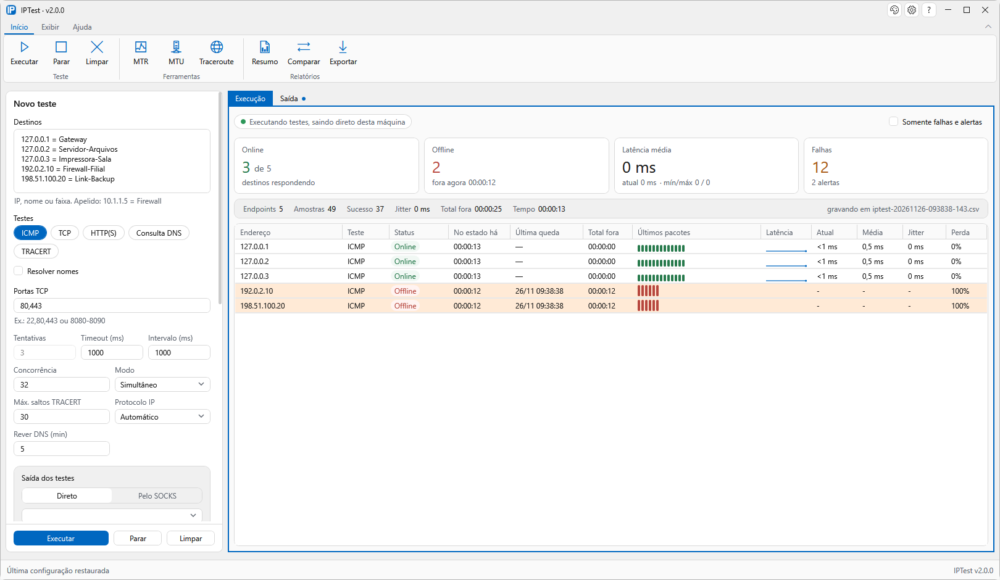
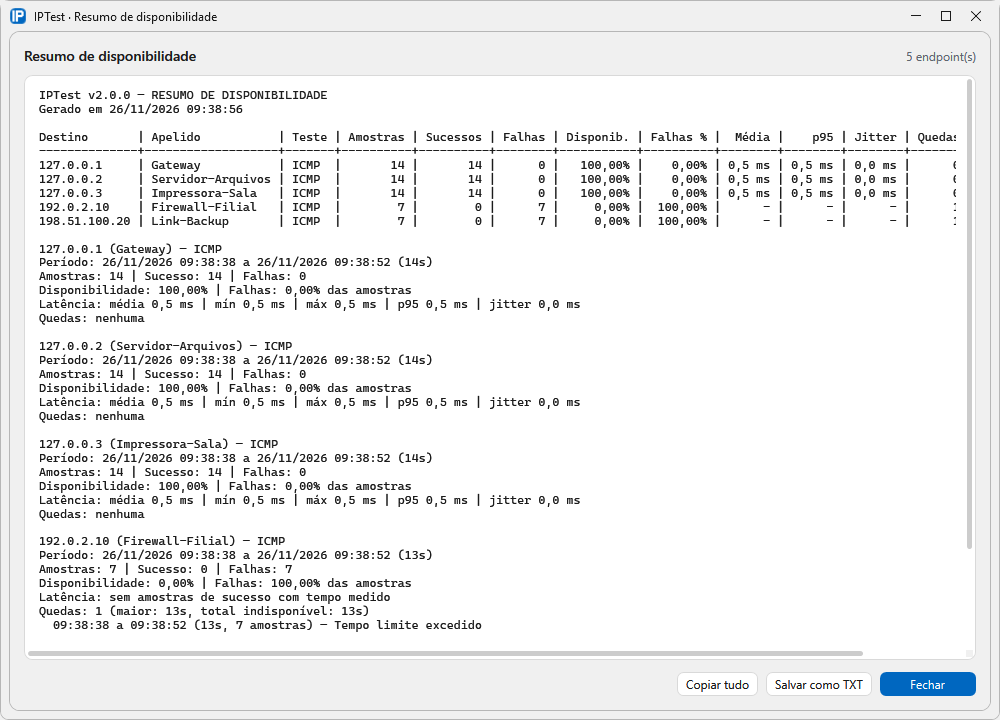

# IPTest-releases

**PT** — Distribuição oficial do IPTest para Windows: pacote portátil (.zip) e instalador (.msi), com as notas de cada versão. Baixe na aba [Releases](https://github.com/Dorflex-DD/IPTest-releases/releases). Este repositório não contém código-fonte. Os mesmos pacotes estão no GitLab: https://gitlab.com/fabioffg/IPTest/-/releases

**EN** — Official Windows distribution of IPTest: portable package (.zip) and installer (.msi), with release notes. Download from the [Releases](https://github.com/Dorflex-DD/IPTest-releases/releases) tab. This repository holds no source code. The same packages are on GitLab: https://gitlab.com/fabioffg/IPTest/-/releases

## Telas / Screenshots (v2.0.0)

**Tela principal / Main window** — PT: testa vários destinos ao mesmo tempo (ICMP, TCP, HTTP, DNS, traceroute) e mostra online, offline, latência e falhas em tempo real. EN: tests many targets at once (ICMP, TCP, HTTP, DNS, traceroute) and shows online, offline, latency and failures live.

**Resumo de disponibilidade / Availability summary** — PT: relatório pronto para anexar ao chamado, com disponibilidade, latência e quedas de cada destino. EN: ready-to-attach report with availability, latency and outages per target.

Dados fictícios / Sample data.
